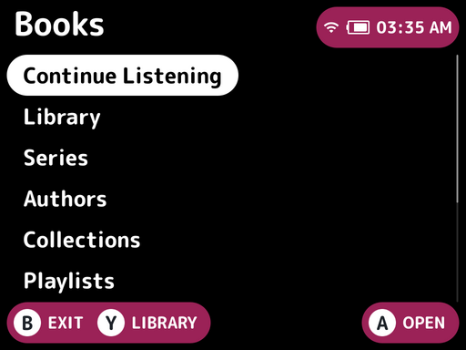
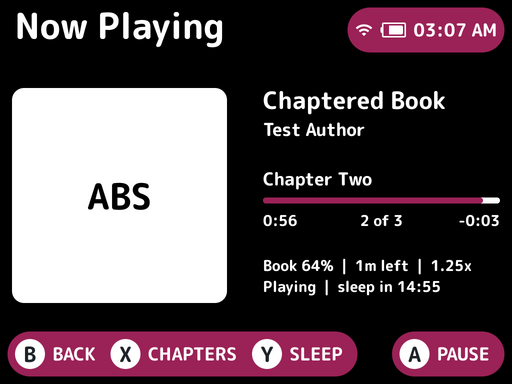
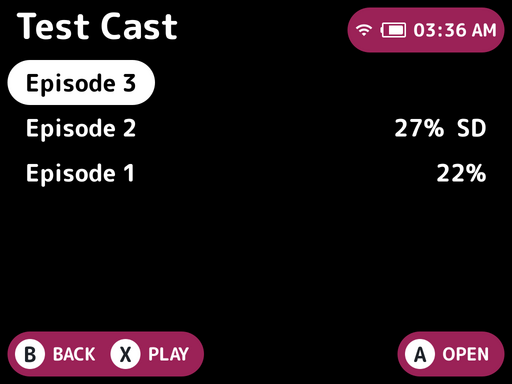
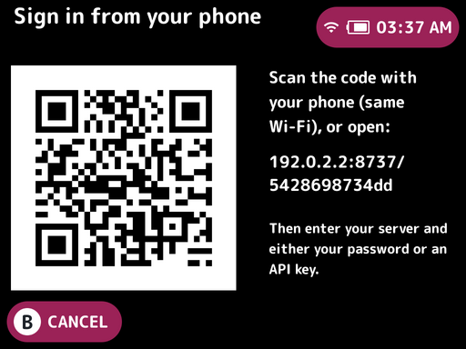

# Audiobookshelf for NextUI

An [Audiobookshelf](https://www.audiobookshelf.org/) client pak for
[NextUI](https://nextui.loveretro.games/) on the TrimUI Brick (and Smart Pro,
which shares the `tg5040` platform). It's inspired by
[AudioBooth](https://github.com/AudioBooth/AudioBooth): browse your library,
stream or download books, and listen with the **screen off** or **while you
play a game**. Podcasts work too.

<p>
 
 
</p>

> **Status: v0.2.0, not yet tested on real hardware.** Everything was built
> with the official NextUI toolchain. The playback service and the device
> ffmpeg were tested end to end against a real Audiobookshelf server, both
> natively and under arm64 emulation. The UI was checked visually at the
> Brick's 1024×768 resolution. Still unverified on a device: backlight
> control, button codes, and whether audio mixes with game audio. See
> [Testing on the device](#testing-on-the-device).

## Features

- **Sign in** with username and password, with an **API key**, or **from your
  phone**. The phone option shows a QR code: open it on a phone on the same
  Wi-Fi and type your details there instead of on the handheld keyboard.
  Works with new (access/refresh token) and legacy Audiobookshelf auth.
- **Books**: Continue Listening, Library (sort by title, author, date added or
  length), **Series** (in reading order), **Authors**, **Collections**,
  **Playlists**, Recently Added, and **Search** (finds books, authors and
  series).
- **Podcasts**: shows with their episodes (newest first), Latest Episodes,
  playlists and search. Each episode has its own progress and can be
  downloaded on its own.
- Book and episode pages with cover, author or podcast, narrator, series,
  length, progress and description.
- Streaming playback of m4b/m4a/mp3/flac/ogg/opus/wma, including books split
  across many files.
- Chapters: L1/R1 to jump, or pick from a list.
- **Bookmarks**: add one at the current spot, list them, jump to one, or delete
  one. Bookmarks added offline are kept on the device and uploaded later.
- Pitch-preserving **playback speed**, 0.5× to 3×.
- **Sleep timer**: 5 minutes to 2 hours, or end of chapter.
- Configurable skip back/forward, with a small rewind when resuming.
- **Downloads** of books and episodes to the SD card for offline listening,
  resumable if interrupted. Downloaded podcasts can be browsed offline.
- **Progress sync** with the server every 15 s and on pause. Listening done
  offline is queued and uploaded when the server is reachable again.
- **Screen off**: a short press of POWER turns the backlight off and audio
  keeps playing. The CPU is clocked down and buttons are ignored until you
  press POWER again. Volume buttons still work.
- **Background playback**: exit the app with *Keep listening* and the book
  keeps playing in the NextUI menu and inside games.
- **In-game controls**: play/pause and skip without leaving your game.
- Progress is saved automatically before the device sleeps or shuts down.

## Install

1. Download `Audiobookshelf.pak.zip` from Releases, or build it (see below).
2. Unzip it and copy the `Audiobookshelf.pak` folder to
   `SD:/Tools/tg5040/` on your SD card.
3. On the device, open **Tools → Audiobookshelf**.
4. Sign in. The easiest way is **Sign in from your phone**: scan the QR code
   with a phone on the same Wi-Fi and fill in the form there. You can also
   enter the server address (e.g. `192.168.1.20:13378` or
   `https://abs.example.com`), username and password on the device.

### Accounts that use SSO / OpenID

The handheld has no web browser to complete an SSO sign-in. Use an **API
key** instead: in Audiobookshelf go to *Settings → API Keys*, create a key for
your user, and paste it into the phone sign-in page (choose *API key*). If
you aren't the server admin, ask them to create one for you.

## Controls

**Everywhere:** POWER (short) turns the screen off/on and keeps playing.
Holding POWER saves progress and shuts down. MENU shows help.

**Now Playing**

| Button | Action |
|--------|--------|
| A | Play / pause |
| LEFT / RIGHT | Skip back / forward (15 s / 30 s by default) |
| L1 / R1 | Previous / next chapter |
| X | Chapter list |
| START | MORE: add bookmark, bookmarks, sleep timer, speed, stop |
| Y | Sleep timer (shortcut) |
| SELECT | Playback speed (shortcut) |
| B | Back to browsing (keeps playing) |

**Home:** Y switches library (e.g. between Books and Podcasts), and X
plays/pauses the loaded book.

**Lists:** A opens, X plays straight away, Y changes sort (Library), B goes
back. On a book or episode page, Y (MORE) offers: play from the beginning or a
chapter, bookmarks, download/remove, and mark finished.

**Leaving the app:** press B on the home screen and choose *Keep listening*
to carry on in the background, or *Stop playback and exit*.

### In-game controls

While a book is loaded and you're outside the app (in a game or the NextUI
menu):

| Buttons | Action |
|---------|--------|
| FN1, or SELECT+START | Play / pause |
| SELECT+L1 | Skip back |
| SELECT+R1 | Skip forward |

The game also receives these presses; that can't be avoided without blocking
input to the game. You can turn in-game controls off in Settings. You can
remap them by editing `hotkeys` in
`.userdata/shared/Audiobookshelf/settings.json`. Buttons: `A B X Y L1 R1 L2
R2 SELECT START MENU FN1 FN2`. Use `+` for chords and `,` for alternatives,
e.g. `"toggle": "FN2,SELECT+Y"`.

## How it works

```
 ┌───────────────┐   unix socket    ┌──────────────────────────────┐
 │ abs-ui (C)    │  /tmp/absd.sock  │ absd (Go, background daemon) │
 │ Apostrophe UI │ ───────────────▶ │ Audiobookshelf API + auth    │
 │ screen-off    │   JSON commands  │ progress sync / offline queue│
 └───────────────┘                  │ downloads, sleep timer       │
                                    │ in-game hotkeys (evdev)      │
                                    │ loopback HTTP → server proxy │
                                    └──────────────┬───────────────┘
                                                   │ spawns
                                         ┌─────────▼─────────┐
                                         │ ffmpeg (bundled)  │ decode + atempo
                                         │ → ALSA "default"  │ → speaker / BT
                                         └───────────────────┘
```

- `launch.sh` starts **absd** detached from the launcher, then runs the UI.
  When you leave the UI, absd keeps running. It exits on its own after a
  few idle minutes once nothing is loaded.
- **absd** plays one audio file at a time through a small bundled ffmpeg
  (1.9 MB, audio only), which writes straight to ALSA. Pausing stops ffmpeg,
  which frees the audio device for games. Remote files are fetched through a
  loopback proxy that adds authentication and handles HTTPS, so ffmpeg needs
  no TLS support.
- The **UI** turns off Apostrophe's suspend-on-power handler and uses its
  own. A short press sets the panel brightness to 0 through `/dev/disp`, the
  same ioctl NextUI uses. It also drops the CPU to its lowest preset and
  filters out all input until the next press.
- **Phone sign-in** serves a one-time page on port 8737 of the device's Wi-Fi
  address, under a random 12-character path. It accepts one successful sign-in
  and then closes; it also closes after 10 minutes or when you cancel.
- A NextUI `pre-sleep.d` hook (`.userdata/tg5040/.hooks/pre-sleep.d/`)
  pauses and syncs before the device suspends.

Files on the SD card:

| Path | Contents |
|------|----------|
| `Tools/tg5040/Audiobookshelf.pak/` | The pak |
| `.userdata/shared/Audiobookshelf/` | Settings, login tokens, local progress, offline sync and bookmark queues, cover cache |
| `Audiobooks/` | Downloaded books (one folder per book, with `manifest.json`); episodes under `Audiobooks/Podcasts/` |
| `.userdata/tg5040/logs/Audiobookshelf*.txt` | UI and daemon logs |

## Testing on the device

Things that still need confirming on real hardware, in rough priority order:

1. **Basic playback**: log in, play a book, and check you hear audio. If you
   don't, check `logs/Audiobookshelf-daemon.txt`.
2. **Screen off**: a short POWER press should blank the screen with audio
   continuing, and the next press should restore the previous brightness.
   The volume buttons should still work while dark.
3. **Behind a game**: start a book, exit with *Keep listening*, and launch a
   game. If the book stops, or the game has no sound, the daemon log will
   show `Audio device is busy`. That means the stock ALSA config doesn't mix
   streams. Please report it, along with the output of
   `cat /etc/asound.conf` and `aplay -L`.
4. **In-game buttons**: check that FN1 toggles playback in a game. The button
   codes were derived from NextUI's tg5040 input map, not read from hardware.
5. **Sleep**: put the device to sleep from the NextUI menu; it should pause,
   and after waking the progress should be on the server.

## Building

Requirements: Go 1.26+ and Docker. The NextUI toolchain image
`ghcr.io/loveretro/tg5040-toolchain` is pulled automatically.

```sh
make            # → dist/Audiobookshelf.pak.zip
make daemon     # build/tg5040/absd    (static arm64 Go binary)
make ui         # build/tg5040/abs-ui  (C, built in the toolchain container)
make ffmpeg     # build/tg5040/ffmpeg  (see scripts/build-ffmpeg.sh)
```

### Desktop development

```sh
sudo apt install libsdl2-dev libsdl2-ttf-dev libsdl2-image-dev ffmpeg
make desktop
ABSD_AUDIO_OUT=null ABSD_FFMPEG=$(which ffmpeg) build/desktop/absd serve &
cd somewhere-with-a-font.ttf && AP_WINDOW_WIDTH=1024 AP_WINDOW_HEIGHT=768 /path/to/build/desktop/abs-ui
```

Keyboard on desktop: arrows, `a` `b` `x` `y`, `l`/`r` for L1/R1, Enter = START,
Space = SELECT, `h` = MENU. Useful daemon environment variables:
`ABSD_AUDIO_OUT=null` (no sound card), `ABSD_SOCKET`, `ABSD_DATA`,
`ABSD_IDLE_EXIT=0`, `ABSD_NO_HOTKEYS=1`.

You can drive the daemon directly too: `absd ctl status`, `absd ctl toggle`,
`absd ctl play '{"id":"<item id>"}'`, `absd ctl skip '{"seconds":-30}'`.

### Tests

```sh
cd daemon && go test ./...        # unit tests
scripts/integration-test.sh       # real Audiobookshelf server in Docker
```

The integration test starts a real server with a book library and a podcast
library, then checks:

- chapters, track changes, server progress and auto-finish;
- downloading, offline playback, and the queued progress uploading on reconnect;
- series order, authors, collections and search;
- bookmarks;
- podcast episodes, including finishing one and the Latest Episodes list;
- API-key login and the phone sign-in page.

## Not yet supported

- True SSO/OpenID sign-in on the device (use an API key; see above).
- Narrator, genre and tag browsing.
- Creating or editing collections and playlists (they're read-only here).
- Adding new podcast episodes from feeds (do that on the server).

## Credits

[AudioBooth](https://github.com/AudioBooth/AudioBooth) for the feature set and
API reference. [Apostrophe](https://github.com/Helaas/Apostrophe) by Kevin
Vranken and [gabagool](https://github.com/BrandonKowalski/gabagool) by Brandon
Kowalski for the NextUI UI toolkits. Jose Diaz-Gonzalez's
[pak guide](https://josediazgonzalez.com/2025/06/16/writing-a-pak-for-the-minui-and-nextui-launchers/).
Third-party licenses are in [`licenses/`](licenses/THIRD_PARTY.md).
